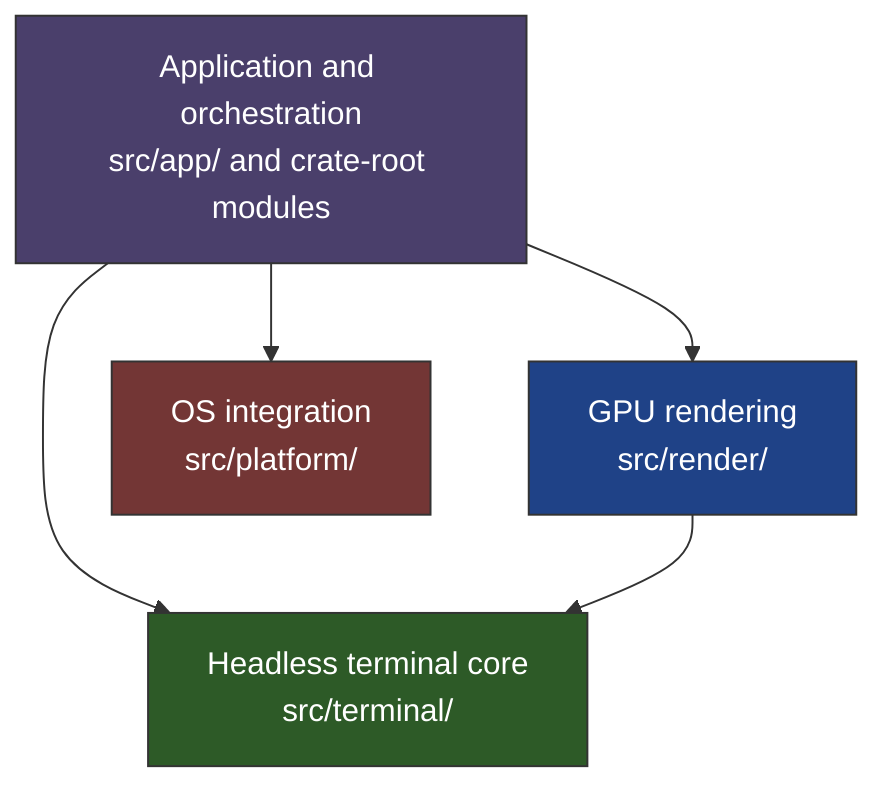

# v0.7.4 — Architecture, concurrency, and quality plan

Current Linux status (2026-11-04): the user confirms all features have been tested
on Linux and run stably. Earlier pending Linux feature checks and Linux-specific
maintenance proposals below are historical, superseded by the
[closed Linux validation status](../validation/linux-status-2026-11-04.md).
Original command results and measurement limits are preserved; this update does
not supply new benchmark numbers or command logs.

Status: released in v0.8.0 on 2026-11-04 (never tagged as v0.7.4). The
paragraph below records the state when the plan was validated; the per-item
statuses further down are current.

Status — validation performed on 2026-11-03 against commit
`56d24b7`, whose production source is still v0.7.2. No item below has been
implemented. Validation used macOS arm64, source inspection, existing tests,
and temporary probes. Limits of each result are recorded below.

[v0.7.3](0.7.3.md) has completed its baseline audit and planning only. All six
implementation items remain open. In particular, `PaneRect` still lives in
`split.rs`, and all five tolerated dependency pairs remain. Version numbers
here identify planned work, and do not establish release or implementation status.

## 1. Architecture and scope

Preserve the 12-byte `Cell`, platform parity, short grid mutex holds, bounded
resources, and existing performance budgets. The <50 MB idle memory invariant
applies on macOS with all windows closed. Open windows have separate budgets.

The contracts enforced by [layering tests](../../src/layering_tests.rs) are

- `terminal` depends only on itself within the crate.
- `render` depends on itself and `terminal`.
- `platform` depends only on itself within the crate.
- `app` and crate-root modules may consume all layers.



Arrows show permitted crate-layer dependencies. Platform and terminal are leaf
layers. Current exceptions are listed below, including `render → platform`.

The five currently tolerated dependency pairs are

| Dependency | Planned owner |
| --- | --- |
| `platform → config` | Section 2.7, platform-owned window styling data |
| `platform → keymap` | Section 2.7, hotkey inputs and menu dispatch |
| `platform → AppEvent` | Section 2.7, callbacks that preserve event data |
| `render → split` | v0.7.3 item 6, move `PaneRect` |
| `render → platform` | Retained Metal surface configuration hook |

Section 2.7 can reduce five exceptions to two independently. Reaching one also
requires completion of v0.7.3 item 6. The PTY benchmark issue noted in v0.7.3's
verification section is tracked for implementation in section 2.2 here.

The items below include reproduced behavior, measured optimization candidates,
and maintenance proposals. Maintenance proposals need a scoped design and
behavior-preservation tests before implementation. Measured mutex contention,
whole-application speedups, and production credential leaks have not been
established by this validation.

## 2. Implementation items and validation

### 2.1. P1 — Make Enter prompt inspection and AI state updates atomic

Location — [keyboard handler](../../src/app/keyboard.rs), `handle_key`.

Source inspection confirms separate grid lock acquisitions for prompt input,
readiness and epoch, AI availability, direct mode, and the final `track`,
`request` or `armed` mutation. The direct path takes four acquisitions in this
block. The branch alternatives do not all execute for a single key press.

A deterministic temporary probe used the real `Grid` and parser with extracted
keyboard decision logic. It read `yo old query`, then joined a second thread
that fed a new prompt containing `different command`, then resumed the original
decision. The epoch changed, while `ai.request` became `old query`. This
establishes a stale-state transition in the extracted logic. The probe did not
invoke the complete window handler or demonstrate an outbound provider request.

- [x] Add a regression test through the production decision path that fails on
      the current stale-state transition. Use deterministic synchronization,
      without sleeps or scheduler-dependent assertions.
- [x] Inspect prompt input, readiness, epoch, availability and direct mode, then
      update the associated grid AI state within one critical section.
- [x] Release the grid lock before updating application UI state, recording
      history, or writing PTY input.
- [x] Preserve direct interception, shell-mediated interception, ordinary
      commands, empty Enter, unavailable integration and alternate-screen behavior.
- [ ] Exercise Enter in the real app and verify ordinary shell execution and AI
      interception. Record what the controlled regression proves separately.

Acceptance — the AI prompt decision and grid mutation share one lock hold.
Other independent handler work may still acquire the grid lock. No blocking I/O
occurs under that lock. The regression fails before the fix and passes afterward.
Runtime contention improvement requires measurement before a speedup is claimed.

Status — implemented (`inspect_enter`, one lock hold; 7 tests). Not yet exercised
in a running app: ordinary shell Enter and AI interception remain to be checked by hand.

### 2.2. P1 — Replace the mislabeled PTY benchmark

Location — [benchmarks](../../src/bench.rs), `run_latency_benchmark`.

The timed loop performs `write` and `read` on a same-process anonymous pipe.
An existing release binary run with `+bench-perf` printed a PTY roundtrip label
with mean 0.001 ms and P99 0.007 ms. Source inspection confirms the measurement
omits the PTY driver, shell and production reader/writer path. The existing
binary was not rebuilt for this probe, so those numbers are illustrative output.

- [x] Keep the pipe measurement under an accurate IPC label.
- [x] Define separate measurements for protocol roundtrip and shell command
      output completion. Use a real master/slave PTY and production reader,
      parser and reply queue for the protocol measurement.
- [x] For DSR roundtrip, have a child in raw mode write `ESC[5n` to its slave
      output and read the exact `ESC[0n` response from its slave input. End timing
      when the child receives the complete reply. `Grid::response` is generated
      by the parser and subsequently queued back to the child, so stopping there
      omits the return path. A `cat` echo child does not provide this endpoint.
- [x] Use bounded deadlines and deterministic cleanup of descriptors, child and
      threads on success, EOF, malformed reply and timeout.
- [ ] Report mean, median, P95 and P99 over 1,000 iterations on macOS and Linux.
      Document the timing boundaries and warmup policy.

Acceptance — report actual PTY measurements with explicit endpoints. Evaluate
mean ≤1 ms and P99 ≤3 ms against the intended workload. A DSR protocol result
alone does not establish shell command-completion latency or rendering latency.

Status — implemented as `+bench-dsr [n]` with a real PTY child (`tests/bench_dsr.rs`).
macOS arm64, 1,000 samples: mean 0.019 ms, P99 0.053 ms, within the 1 ms / 3 ms
targets. The Linux run is still pending; shell command completion is not measured.
macOS re-run on 2026-11-12 (3 × 1,000 samples, 100 warmup): mean 0.024–0.028 ms,
median 0.021–0.023 ms, P95 0.045–0.051 ms, P99 0.076–0.088 ms; endpoints and
warmup are in `src/bench_dsr.rs`. See the
[close-out report](../validation/2026-11-12-macos-closeout.md). The box stays open
for the Linux run only.

### 2.3. P2 — Separate graphics protocol and storage responsibilities

Location — [graphics](../../src/terminal/graphics.rs), 1,860 lines at baseline.

Source inspection confirms Sixel decoding, Kitty commands and chunk assembly,
CPU image storage and placements, and Kitty animation playback share this file.
GPU texture upload belongs to the render layer. The earlier description of
GIF/APNG playback timers and source ranges was inaccurate. This is a maintenance
proposal without a reproduced functional failure or measured runtime benefit.

- [x] Split cohesive responsibilities into `graphics/{mod,sixel,kitty,store,animation}.rs`
      where appropriate. Preserve the existing `Store` interface and image limits.
- [x] Keep GPU operations in render and CPU image/protocol state in terminal.
- [x] Preserve existing test assertions, moving tests or adjusting module paths
      only as needed. Cover decoding failures, chunking, placements and animation.
- [x] Compare allocation behavior for placement and scrolling before and after.

Acceptance — clearer ownership, unchanged protocol behavior and memory bounds,
and no additional hot-path allocations. File length alone is not a correctness
or performance criterion.

Status — implemented. `graphics/{mod,animation,store,kitty,sixel,tests}.rs`; every
public path is re-exported unchanged, all 23 graphics tests moved as they were. The new
test `warm_placement_scroll_and_visible_paths_do_not_allocate` shows 0 allocations for
`place`, `visible`, `scroll_alt`, `scroll_alt_down`, `prune` and `delete_lines`, both
before and after the split.

### 2.4. P2 — Remove the updater's dependency on the AI JSON module

Locations — [updater](../../src/update.rs), [JSON](../../src/ai/json.rs).

The updater imports `crate::ai::json::{Json, MAX_JSON_DEPTH}` and combines HTTP,
version parsing, checksum/signature verification, extraction and installation.
The dependency is confirmed. No updater malfunction caused by it was reproduced.

- [x] Move the shared JSON implementation to a common location and update both
      callers. Coordinate with v0.7.3's serialization work to preserve its tests.
- [x] Split updater responsibilities into `update/{mod,client,verify,install}.rs`
      while preserving pinned signature validation and atomic replacement.
- [x] Keep SHA-256 with updater verification unless another caller needs it.
      Avoid expanding permitted layer dependencies solely to relocate a parser
      used by two crate-root modules.
- [x] Run parser, update verification and installation failure-path tests.

Acceptance — no `update → ai` dependency, equivalent parsing and updater behavior,
and intact signature/hash rejection tests.

Status — implemented. `json` lives at the crate root, `update/{mod,client,verify,install}.rs`
replaces `update.rs`, and all 19 updater tests pass. The CWE-321 source scan in
`security_poc.rs` now reads the four updater files.

### 2.5. P2 — Separate history popup state from history parsing

Location — [history](../../src/terminal/history.rs), 1,466 lines at baseline.

`HistorySearch` owns popup open/close state, query edits, selection and pagination.
Rendering also consumes this type directly in frame construction, geometry and
popup drawing. History matching uses the project's own matcher. The earlier
Nucleo attribution was incorrect. Current layer tests pass because the type is
inside `terminal`; this is a responsibility-separation proposal.

- [x] Move interactive state to `app/history_ui.rs` while preserving history
      parsing, matching and persisted-history behavior.
- [x] Define a borrowed render-facing view for visible rows, selection and query
      display. Update all renderer consumers without introducing `render → app`.
- [x] Preserve navigation, deletion, wrapping, highlighting and popup geometry.
      Coordinate with v0.7.3 warm-overlay allocation work.
- [ ] Run history and layering tests and exercise the popup in the real app.

Acceptance — UI state has an explicit owner, the terminal layer retains headless
history operations, and popup behavior and allocation budgets are preserved.

Status — implemented (`HistoryStore`, `app/history_ui.rs`, `render::HistoryView`). The
warm-overlay allocation test reports 0 allocations for the popup. Not yet exercised in
a running app.

### 2.6. P2 — Index bundled theme lookup

Location — [configuration](../../src/config.rs), `bundled_theme` and `apply_theme`.

The 422,568-byte asset contains 861 themes. A temporary harness compiled the
existing `bundled_theme` function with `rustc -O` and used `black_box` for 2,000
lookups per name. Observed mean times on macOS arm64 were

| Theme position | Theme | Time per lookup |
| --- | --- | --- |
| First | `0x96f` | 0.21 µs |
| Middle | `Lumina Oxblood Light` | 68.14 µs |
| Last | `Zenwritten Light` | 131.84 µs |

The linear scan and position-dependent cost are measured. Visible theme-switch
lag and whole-application benefit remain unverified.

- [x] Evaluate a static or bounded one-time index mapping names to asset slices.
- [x] Preserve case-insensitive names, missing-name behavior, external theme-file
      precedence and built-in aliases.
- [x] Measure lookup, full theme application, index initialization and retained
      memory before and after using the same fixtures.

Acceptance — equivalent theme results and documented cost reduction. The original
<1 µs target remains experimental. Decomposing the entire `Config` is a separate
maintenance proposal requiring its own scope and approval before implementation.

Status — implemented with a one-time `OnceLock` index and binary search. Same
harness, macOS arm64 (linear → indexed): first 0.31 → 0.21 µs, middle 135.20 →
0.09 µs, last 257.26 → 0.06 µs per lookup. Behavior tests for case-insensitive
names, aliases and external theme files pass.

### 2.7. P3 — Reduce platform layering exceptions

Location — [layering tests](../../src/layering_tests.rs), `TOLERATED`.

All five exceptions in section 1 remain. `cargo test layering_tests` passed all
four layer tests during validation. Removal of `render → split` is pending in
v0.7.3. These tolerated dependencies establish maintenance work rather than a
newly reproduced runtime failure.

- [x] Introduce platform-owned window styling data for `apply_window_config`.
- [x] Pass resolved keycodes/modifiers to hotkey integration and account for
      native menus that currently dispatch `keymap::Action`.
- [x] Define per-action bound callbacks or platform-owned event data that retain
      the selected menu action and system appearance's `dark` value, as well as
      reopen, hotkey and socket behavior. A zero-argument callback needs bindings
      that preserve those distinctions.
- [x] Preserve macOS/Linux API parity and verify menu selection, appearance,
      reopen and quick-terminal dispatch. (Checked in the running macOS app by
      the user in the macOS smoke test on 2026-11-12.)
- [x] Remove only eliminated exceptions. Expect 5 → 2 for this item, or 4 → 1
      if v0.7.3 item 6 has already landed.

Acceptance — platform no longer imports `config`, `keymap` or `AppEvent`, with
behavior preserved. A remaining render-to-platform hook is explicitly tolerated.

Status — implemented. `TOLERATED` now holds only `render → platform`. Menu, Dock, hotkey
and appearance dispatch are covered by unit tests but not yet exercised in a running app.

### 2.8. P3 — Specify configurable AI invocation and outbound redaction

Locations — [AI query handling](../../src/ai/mod.rs) and `src/shell/` integrations.

The `yo` trigger is fixed in Rust and shell scripts. Bash, Zsh, Fish and Nushell
define `yo`; Bash, Zsh and Fish also intercept it in Enter handlers. Existing PTY
smoke tests passed on Bash, Zsh and Nushell. Fish was absent and skipped locally.
A real Yeoman executable collision was not exercised in this validation.

A temporary copy of `tool_loop_reads_grid_and_preserves_actual_execution`
placed `password=LITTY_FAKE_PROBE_074` in grid output. Its local HTTP server
captured that exact string in the request body after the scrollback tool ran.
The assertion passed. This proves lack of redaction for that path and fixture.
Only synthetic data and a loopback server were used. This does not establish a
real credential disclosure or coverage of every provider and payload type.

- [x] Agree on trigger syntax, default, disable semantics and reload behavior
      before implementing a new configuration key.
- [x] Apply trigger settings consistently to Rust matching and all four shell
      integrations. Test a stub executable named `yo` receiving `yo generator`
      when the AI trigger is disabled or renamed.
- [x] Define redaction coverage and replacement rules for queries, tool output,
      continuation output, retained messages and compaction requests. Specify
      false-positive handling and multiline private-key boundaries.
- [x] Test synthetic AWS/GitHub token formats, Bearer tokens, private keys and
      password assignments, plus ordinary text that must remain unchanged.
- [x] Capture actual outbound bodies at a local HTTP server and verify filtering
      occurs before network dispatch. Specify notification behavior for redaction.

Acceptance — consistent configurable invocation and tested filtering for the
agreed patterns across outbound paths. Pattern filtering offers bounded coverage;
its limits must be documented with the configuration and UI behavior.

Status — implemented with the agreed design: `ai-trigger` (default `yo`, `off`
disables, validated single word), live in Rust and read at shell start through
`LITTY_AI_TRIGGER`; fixed `[REDACTED:kind]` patterns with a status-line count.
PTY tests with real zsh, Bash and Nushell cover a renamed and a disabled trigger
against a stub `yo`; fish is not installed here, so its script is untested. A
loopback server captures the outbound bodies and shows no raw secret on the
query, tool-output, continuation, execution and compaction paths. Limits are
documented in `docs/guide/ai-assistant.md`.

## 3. Verification record and implementation gates

Validation already performed on the baseline includes

- `cargo test layering_tests` — 4 passed.
- `cargo test --test layering_tests` — exit 101, no such integration-test target.
  The correct command is the unit-test filter above.
- `cargo test --test yo_shells -- --nocapture` — Cargo reported 4 passed, but Fish
  returned early because it was not installed. Three shells were exercised.
- Temporary `audit_epoch_interleave` — 1 passed, asserting that the stale request
  was produced by extracted keyboard logic. A passing assertion records the bug.
- Temporary `tool_loop_reads_grid_and_preserves_actual_execution` with synthetic
  password output — 1 passed, asserting the marker reached the HTTP request.
- `target/release/litty +bench-perf` — exit 0 on a pre-existing release binary.
  An initial output-truncated invocation caused a broken-pipe panic; rerunning
  with output redirected to a file completed. Its PTY label remains invalid.
- Optimized theme lookup probe — timings recorded in section 2.6.

Temporary probes were not added to the repository and are not durable regression
coverage. Incorporate production-path regressions before implementing fixes.
The full build/lint suite, Linux runtime checks and real-window race reproduction
were outside this validation. No implementation acceptance box is complete.

For each implementation, run the relevant regression and the project checks

```sh
cargo check
cargo check --target x86_64-unknown-linux-gnu
cargo test # outside the sandbox for PTY tests
cargo test layering_tests
cargo clippy --all-targets -- -D warnings
git diff --check
```

Run `cargo run --release -- +bench-ram` and `cargo run --release -- +bench-perf`
for performance-sensitive changes and release validation. Interpret their actual
measurement boundaries, as described in [v0.7.3](0.7.3.md). Use comparable fixtures
and repeated measurements for performance claims. Record missing environments
and skipped tests explicitly. Obtain independent review for non-trivial changes,
update this plan and `ROADMAP.md` on completion, and update `README.md` for
user-visible behavior or configuration changes.
