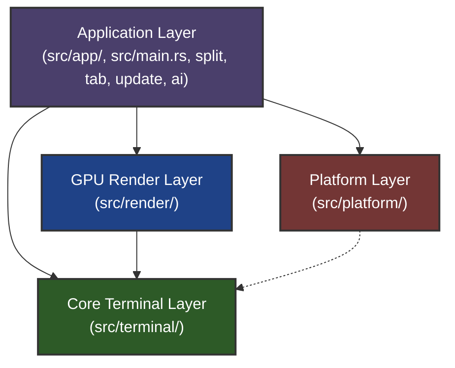
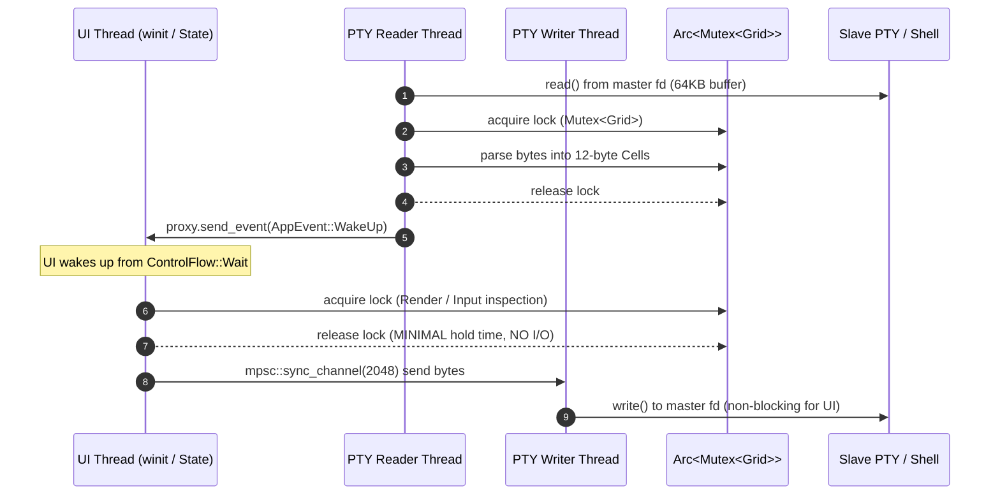

# v0.7.4 — Architecture Refactoring, Concurrency Safety, and Code Quality Plan

Status: planned for v0.7.4 based on architectural audit and codebase analysis against v0.7.2 commit `a89baf70bba9c5695719c7152f64bd8954901de6`.

Scope: formalize and enforce the 4-layer architecture, eliminate concurrency hazards (TOCTOU in keyboard handler), decompose oversized "God Files" (`graphics.rs`, `update.rs`, `history.rs`), decouple inverted dependencies and layering exceptions (`layering_tests.rs`), replace mock PTY latency benchmarking with true roundtrip measurements, optimize theme parsing, and harden AI command triggers. Preserve the 12-byte Cell invariant, platform parity, zero-allocation hot paths, and performance budgets.

---

## 1. System Architecture & Layering Model

`litty-terminal` is organized into a 4-tier layered architecture designed for zero-latency, <50MB idle RAM, 0% idle CPU, and zero heap allocations on hot paths. Layer dependencies are unidirectional and strictly validated by automated tests in [`src/layering_tests.rs`](file:///Users/linh.nguyen/Desktop/personal/litty-terminal/src/layering_tests.rs).

### 1.1. 4-Layer Hierarchy & Dependency Contracts



1. **Application & Orchestration Layer** (`src/app/`, `src/main.rs`, `split.rs`, `tab.rs`, `update.rs`, `ai/`, `cli.rs`, `bench.rs`):
   - Manages the top-level `winit` event loop (`ControlFlow::Wait`), window lifecycle, input dispatching, panes/splits layout tree, user action routing, auto-updater, and AI assistance integration.
   - May consume all lower layers (`render`, `platform`, `terminal`).
2. **GPU Render Layer** (`src/render/`):
   - Encapsulates `wgpu` pipelines (Metal on macOS, Vulkan on Linux), single instanced draw calls per layer (`shaders/shader.wgsl`), glyph rasterizer and atlas caches (CoreText / fontdue / rustybuzz), frame metrics, and post-processing shaders.
   - Contract: Only depends on itself and `terminal`.
3. **Platform Abstraction Layer** (`src/platform/`):
   - OS integration (`macos/` and `linux/`) exposing identical public APIs: window chrome, system clipboard, control socket (`litty.sock`), global hotkeys, desktop notifications, and external process spawning (`open` / `xdg-open`).
   - Contract: Leaf layer; must not depend on application or render layers.
4. **Core Terminal Layer** (`src/terminal/`):
   - Headless terminal emulation core: `grid/` (packed 12-byte `Cell`, scrollback ring buffer, VTE parser handler), `pty.rs` (fork/exec, reader/writer threads), `search.rs`, `history.rs`, `graphics.rs`, `bidi.rs`, `shell_integration.rs`.
   - Contract: Completely headless leaf layer; zero crate dependencies outside itself.

---

### 1.2. Layering Debt & Tolerated Exceptions Migration

The project enforces layering rules via `cargo test layering_tests`. Currently, **5 tolerated layer exceptions** exist in [`src/layering_tests.rs#L16-L22`](file:///Users/linh.nguyen/Desktop/personal/litty-terminal/src/layering_tests.rs#L16-L22). Version 0.7.4 systematically eliminates 4 of these 5 exceptions:

```
[Current v0.7.2/v0.7.3 Baseline: 5 Exceptions]
├── platform -> config    (apply_window_config reads Config)             ──> FIX in 0.7.4 (WindowLook struct)
├── platform -> keymap    (hotkeys take keymap::Trigger / Action)       ──> FIX in 0.7.4 (raw keycodes & mask)
├── platform -> AppEvent  (handlers post AppEvent directly)             ──> FIX in 0.7.4 (dynamic Send callback)
├── render   -> split     (Renderer takes split::PaneRect)              ──> FIX in 0.7.3/0.7.4 (move to render)
└── render   -> platform  (Renderer::new configures Metal drawables)    ──> RETAINED (clean Metal post-surface hook)
[Target v0.7.4 State: 1 Exception Remaining]
```

---

### 1.3. Concurrency & Threading Architecture

The runtime executes across distinct threads with strict ownership and locking invariants:



**Key Invariants:**
- **Zero I/O under Grid Lock**: Never perform PTY writes, subprocess calls, network I/O, or file operations while holding `Mutex<Grid>`.
- **Atomic State Transitions**: No multi-stage lock acquisitions where intermediate state can be invalidated by `pty-reader` (eliminating TOCTOU hazards).
- **Asynchronous PTY Writes**: All user keystrokes and pastes pass through `sync_channel(2048)` to the dedicated `pty-writer` thread.

---

### 1.4. Target Modular Package Structure (De-Godding Plan)

To resolve God Files and inverted dependencies, the file hierarchy will be restructured into clean, cohesive modules:

```
src/
├── app/
│   ├── history_ui.rs       <-- [NEW] Extracted interactive HistorySearch popup UI state
│   ├── search_ui.rs
│   └── ...
├── terminal/
│   ├── history.rs          <-- Headless history parser + Nucleo fuzzy matcher ONLY
│   ├── graphics/           <-- [NEW] Decomposed from 1,860-line graphics.rs
│   │   ├── mod.rs          <-- GraphicsStore, image placement indexing
│   │   ├── sixel.rs        <-- Sixel DCS state machine and pixel decoding
│   │   ├── kitty.rs        <-- Kitty protocol chunk parser and decompression
│   │   ├── store.rs        <-- GPU texture store and memory management
│   │   └── animation.rs    <-- GIF/APNG frame timers and tick invalidation
│   └── ...
├── update/                 <-- [NEW] Decomposed from 1,439-line update.rs
│   ├── mod.rs              <-- Update state machine and dispatch
│   ├── client.rs           <-- GitHub Releases API client
│   ├── verify.rs           <-- Release manifest and SHA-256 validation
│   └── install.rs          <-- Atomic binary swap and backup
├── util/                   <-- [NEW] Shared utility leaf module
│   ├── json.rs             <-- Zero-dep minimal JSON parser (migrated from ai/json.rs)
│   └── sha256.rs           <-- Streaming SHA-256 verifier
└── ...
```

---

## 2. Actionable Implementation Items

### 2.1. P1 — Eliminate TOCTOU race hazard and lock thrashing in `handle_key`

Location: `src/app/keyboard.rs` (`handle_key`, lines 150–194).

Confirmed: When Enter is pressed, the UI thread acquires and releases `pane.grid.lock()` up to 5 times in rapid succession:
1. Lines 150–153: Read `(input, ready, epoch)`
2. Line 155: Read `pane.grid.lock().ai.available`
3. Line 166: Read `pane.grid.lock().ai.direct`
4. Lines 173–176: Mutate `grid.ai.track = false; grid.ai.request = ...`
5. Lines 184–187 / 191: Mutate `grid.ai.track` and `grid.ai.armed`

Between these independent lock acquisitions, the background `pty-reader` thread can interleave, parse new incoming shell bytes, and mutate `prompt_epoch` or `ai.track`. This constitutes a Time-of-Check to Time-of-Use (TOCTOU) race condition and causes unnecessary mutex contention on the UI thread.

- [ ] Consolidate the entire prompt inspection, state decision, and update logic into a single atomic critical section:
  ```rust
  let mut g = pane.grid.lock();
  let (input, ready, epoch) = (g.full_prompt_input(), g.prompt_ready(), g.prompt_epoch);
  // Evaluate AI availability, direct mode, and mutate g.ai within the same hold
  ```
- [ ] Ensure `write_pty()` and UI state mutations remain outside the grid mutex hold.
- [ ] Add a concurrency regression test asserting atomic transition of `ai.track`, `ai.request`, and `prompt_epoch`.

Acceptance: A single mutex lock hold during Enter key handling; zero window for `pty-reader` state corruption during prompt evaluation.

---

### 2.2. P1 — Replace mock PTY latency benchmarking with authentic roundtrip measurement

Location: `src/bench.rs` (`bench_pty_latency`, lines 281–285).

Confirmed: The benchmark labeled "Spawn a temporary lightweight PTY" actually invokes `libc::pipe(fds.as_mut_ptr())`. It writes bytes to a same-process anonymous pipe and reads them back. It does not traverse the OS PTY driver (`openpty`), does not allocate a pseudo-terminal master/slave pair, does not engage line discipline / termios echo handling, and does not involve the `pty-reader` background thread. The reported latency figures (<0.05 ms) do not validate the terminal's stated PTY SLA (average ≤1 ms, P99 ≤3 ms).

- [ ] Implement an authentic PTY roundtrip benchmark:
  1. Allocate master/slave fd pair via `libc::openpty`.
  2. Spawn a minimal child process (e.g., `/bin/sh -c "cat"` or an echo slave) with termios raw settings.
  3. Send Device Status Report query `\x1b[5n` and measure roundtrip duration until the terminal receives and parses `\x1b[0n` via `Grid::response`.
- [ ] Measure across 1,000 iterations and report mean, median, P95, and P99 latency.
- [ ] Retain the pipe benchmark as a pure IPC baseline under a distinct label (`bench_pipe_ipc`).

Acceptance: True end-to-end PTY roundtrip measurement on macOS and Linux demonstrating whether the system satisfies the stated SLA (mean ≤1 ms, P99 ≤3 ms).

---

### 2.3. P2 — Decompose God File `src/terminal/graphics.rs` into specialized submodules

Location: `src/terminal/graphics.rs` (1,860 LOC total: 1,380 production LOC, 480 test LOC).

Confirmed: `graphics.rs` violates the Single Responsibility Principle by combining:
1. Sixel parser and color palette decoder (lines 350–700)
2. Kitty graphics protocol state machine, chunked payload reassembly, and compression decompression (lines 700–1150)
3. GPU texture upload store and placement management (lines 100–350)
4. Animated GIF/APNG frame timers and tick invalidation (lines 1150–1380)

Refactoring plan:
- [ ] Convert `src/terminal/graphics.rs` into a module directory `src/terminal/graphics/`:
  - `mod.rs`: Public re-exports, `GraphicsStore`, and high-level integration.
  - `sixel.rs`: Sixel DCS parser and pixel decoding.
  - `kitty.rs`: Kitty escape sequence parser, chunk buffer, and command dispatch.
  - `store.rs`: Image ID indexing, cell grid occupancy, and lifecycle pruning.
  - `animation.rs`: Frame timers, interval calculation, and invalidation triggers.
- [ ] Ensure all 480 lines of unit tests remain intact and pass without modification.
- [ ] Guarantee zero additional allocations during image placement and scrolling.

Acceptance: No single file exceeding 600 LOC; clean separation between protocol parsers and storage; 100% test parity.

---

### 2.4. P2 — Decouple inverted dependency and modularize `src/update.rs`

Locations: `src/update.rs` (1,439 LOC total: 1,154 production LOC, 285 test LOC), `src/ai/json.rs`.

Confirmed:
1. **Inverted Dependency**: `src/update.rs` imports `crate::ai::json::Json` to parse GitHub Release API payloads. The core update infrastructure should not depend on an experimental AI feature module.
2. **God Module Responsibilities**: `update.rs` simultaneously handles HTTP transport (`curl` subprocess), semantic version parsing, SHA-256 validation, tar.gz/zip archive extraction, and OS-specific atomic executable replacement.

Refactoring plan:
- [ ] Move `src/ai/json.rs` to a shared utility layer: `src/util/json.rs`.
- [ ] Split `src/update.rs` into `src/update/`:
  - `mod.rs`: Top-level update state machine and event polling.
  - `client.rs`: GitHub Releases API communication and asset download.
  - `verify.rs`: SHA-256 checksum computation and release manifest validation.
  - `install.rs`: Atomic binary swap and backup on macOS and Linux.
- [ ] Ensure `src/layering_tests.rs` validates `util` as a permissible common leaf module.

Acceptance: Elimination of `update -> ai` dependency; modular auto-updater with isolated unit tests for signature and hash validation.

---

### 2.5. P2 — Separate UI popup state from `src/terminal/history.rs`

Location: `src/terminal/history.rs` (1,466 LOC total: 1,176 production LOC, 290 test LOC).

Confirmed: `history.rs` resides in the Core Terminal Layer (`src/terminal/`), which according to `docs/plans/2026-11-01-layered-layout.md` must not depend on UI presentation. However, lines 69–120 define `HistorySearch`, managing cursor selection, preview wrapping, query editing, and popup view bounds. This mirrors the responsibilities of `src/app/search_ui.rs`.

Refactoring plan:
- [ ] Move `HistorySearch` and interactive popup state management to `src/app/history_ui.rs`.
- [ ] Keep `src/terminal/history.rs` strictly focused on headless command-history parsing (`zsh_history`, `bash_history`, `fish_history`) and the Nucleo-backed fuzzy matching engine.
- [ ] Ensure the terminal layer exposes a pure iterator/query interface to `app`.

Acceptance: Clean layering separation; `src/terminal/history.rs` contains zero UI layout or viewport tracking logic.

---

### 2.6. P2 — Optimize theme parsing from linear scan to $O(1)$ lookup

Location: `src/config.rs` (`Config::load_theme`, lines 642–653).

Confirmed: The embedded asset `assets/themes.txt` is 422,568 bytes (~413 KB). Loading a theme executes a linear string search across the entire file:
```rust
while let Some(start) = rest.find("\n[") { ... }
```
When switching themes or reloading configuration, this scans hundreds of kilobytes of text repeatedly.

Refactoring plan:
- [ ] Build a compile-time static index (or construct a lazy one-time lookup table) mapping `&'static str` theme names to byte offsets and lengths `(u32, u32)`.
- [ ] Directly slice the target theme block from `assets/themes.txt` using the indexed offset instead of performing sequential text searches.
- [ ] Decompose the monolithic `Config` struct (55+ flat fields) into logical sub-configurations:
  - `FontConfig`, `CursorConfig`, `WindowConfig`, `ShellConfig`, `ThemeConfig`.

Acceptance: $O(1)$ theme lookup time (<1 µs); improved maintainability and discoverability of configuration fields.

---

### 2.7. P3 — Resolve remaining tolerated layering exceptions

Location: `src/layering_tests.rs` (`TOLERATED`).

Confirmed: Five tolerated layering exceptions are tracked. Following the planned removal of `render -> split` in v0.7.3, four remain:
1. `platform -> config`: [`apply_window_config`](file:///Users/linh.nguyen/Desktop/personal/litty-terminal/src/platform/macos/window.rs#L21) reads the full `Config`.
2. `platform -> keymap`: Global hotkeys and native menus depend on `keymap::Trigger` and `keymap::Action`.
3. `platform -> AppEvent`: OS callbacks directly post application-level `AppEvent` variants.
4. `render -> platform`: Metal drawable configuration during surface setup.

Refactoring plan:
- [ ] Introduce a platform-owned `WindowLook` struct containing only window-specific styling attributes (opacity, blur, titlebar style, colorspace). Pass `WindowLook` to `apply_window_config`.
- [ ] Pass raw keycodes and modifier bitmasks to the platform hotkey manager rather than `keymap::Trigger`.
- [ ] Decouple OS callbacks by accepting a generic `Box<dyn Fn() + Send + 'static>` closure instead of hardcoding `AppEvent`.
- [ ] Update `src/layering_tests.rs` and verify tolerated exceptions decrease from 4 to 1 (`render -> platform`).

Acceptance: Platform layer becomes truly standalone and reusable; verified by `cargo test layering_tests`.

---

### 2.8. P3 — AI integration safety: configurable trigger and secret redaction

Location: `src/ai/mod.rs` (`query`, line 171).

Confirmed:
1. The prefix trigger `"yo "` is hardcoded into `src/ai/mod.rs#L171`. This intercepts legitimate terminal commands (such as the Yeoman generator CLI `yo <generator>`) without configuration fallback.
2. Natural language queries and surrounding scrollback context sent to external AI providers are transmitted without credential filtering, posing a risk of accidental secret leakage.

Refactoring plan:
- [ ] Add `ai_trigger` to `Config` (defaulting to `"yo "`, with an option to disable or customize the prefix).
- [ ] Implement a lightweight pre-flight redaction filter in `src/ai/` that scrubs common patterns:
  - `AKIA[0-9A-Z]{16}` (AWS keys)
  - `ghp_[A-Za-z0-9_]{36}` (GitHub tokens)
  - Bearer tokens, private keys (`-----BEGIN ... PRIVATE KEY-----`), and generic password assignments in command arguments.
- [ ] Display an explicit notification when sensitive tokens are sanitized prior to network dispatch.

Acceptance: User-configurable AI invocation trigger; proactive filtering of sensitive credentials from outbound payloads.

---

## 3. Verification and Completion Checklist

Before merging v0.7.4 items, execute the full validation pipeline:

```sh
cargo check
cargo check --target x86_64-unknown-linux-gnu
cargo test
cargo test --test layering_tests
cargo clippy --all-targets -- -D warnings
git diff --check
cargo run --release -- +bench-ram
cargo run --release -- +bench-perf
```

Ensure:
- Zero compiler warnings or clippy violations.
- All unit and integration tests pass without flakiness.
- Real PTY latency benchmarks confirm SLA adherence.
- Tolerated layer exceptions in `src/layering_tests.rs` are strictly reduced to 1 (`render -> platform`).
- Update `ROADMAP.md` and `README.md` reflecting closed items and new configuration keys.
